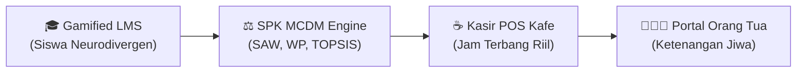

# BREWTECH PITCH DECK (16:9 Widescreen Presentation)
> **Empowering Inclusive Vocational Education & Commercial Coffee Ecosystem**
> *Live System URL: [https://brewtech-v2.vercel.app](https://brewtech-v2.vercel.app)*

---

## Slide 1: Cover (The Executive Hook)
- **Title:** BREWTECH — Inclusive Vocation Platform
- **Tagline:** Memberdayakan talenta penyandang disabilitas dari ruang kelas vokasi SLB, diuji dengan sains keputusan (SPK MCDM), hingga terserap mandiri di mesin kasir POS kafe komersial.
- **Traction Snapshot:** 65 Siswa Binaan • 11 SLB Percontohan • 11 Mitra Industri Kafe
- **Mockup:** Laptop Frame menampilkan Landing Page Hero & Realtime National Counter.

---

## Slide 2: The Burning Problem
- **Charity Trap:** Lulusan disabilitas hanya dianggap penerima donasi sosial, bukan pekerja terampil yang menghasilkan nilai komersial nyata.
- **Ketiadaan Standar Industri:** SLB mengajarkan keterampilan barista namun tanpa kurikulum standar industri (SOP mesin espresso, rasio kalibrasi, sanitasi bar).
- **Keraguan Mitra Kafe:** Pemilik kafe ingin inklusif tapi takut operasional terganggu karena tidak memiliki data objektif terkait kesiapan kerja siswa.
- **Kecemasan Orang Tua:** Orang tua dihantui rasa cemas tentang masa depan sang anak saat mereka kelak sudah tiada.
- **Fakta:** >85% lulusan SLB di Indonesia menganggur setelah sekolah.

---

## Slide 3: The 4-Pillar Integrated Solution

1. **Gamified LMS:** Micro-learning visual, video brewing, dan kuis ramah disabilitas berhadiah badges & bintang.
2. **Engine SPK MCDM:** Sistem pendukung keputusan ilmiah 3 algoritma berbasis 6 kriteria kejuruan (C1-C6).
3. **Kasir POS Kafe Mitra:** Aplikasi POS layar sentuh yang merekam nama siswa barista per cangkir pesanan.
4. **Portal Orang Tua:** Pemantauan langsung riwayat modul, evaluasi karakter guru, dan portofolio anak.

---

## Slide 4: Product Deep-Dive 1 — Student Gamified LMS
- **Desain Khusus:** Micro-learning visual untuk siswa Autisme, Rungu, Sensorik, dan Intelektual.
- **Accessibility Toolbar:** Text-to-Speech (TTS), filter buta warna (Protanopia/Deuteranopia), font OpenDyslexic, kontras tinggi.
- **Kuis & Simulasi:** Latihan interaktif takaran espresso dan rasio pour-over tanpa kecemasan kognitif.
- **Mockup:** Laptop & Mobile screen menampilkan Dashboard Siswa & Pratinjau Kuis Modul.

---

## Slide 5: Product Deep-Dive 2 — Scientific MCDM Decision Engine
- **3 Algoritma Ilmiah:** Simple Additive Weighting (SAW), Weighted Product (WP), dan TOPSIS (Ideal Solution Closeness).
- **6 Kriteria Kejuruan:** C1 Teknis Seduh (30%), C2 Disiplin (15%), C3 Higienitas Bar (20%), C4 Tim (15%), C5 Komunikasi (10%), C6 Inisiatif (10%).
- **Transparansi Matriks:** Tombol *"MATRIKS ILMIAH"* menampilkan Matriks X asal, Normalisasi R, Matriks Terbobot Y, Solusi Ideal A+/A-, dan Vektor S/V.
- **Mockup:** Widescreen laptop mockup menampilkan Laporan SPK dan Tab Switcher Algoritma.

---

## Slide 6: Product Deep-Dive 3 — Commercial Cafe POS Cashier
- **Layar Sentuh Kasir:** Pemrosesan pesanan cepat (Espresso, Latte, Matchabiyu), kalkulasi diskon, split-bill, dan cetak struk thermal.
- **Assignment Siswa:** Kasir menetapkan barista siswa magang yang meracik pesanan &rarr; rekam jam terbang nyata.
- **HPP & Stok:** Manajemen stok bahan baku dan perhitungan harga pokok penjualan otomatis.
- **Mockup:** Tablet / iPad POS mockup menampilkan antarmuka kasir layar sentuh.

---

## Slide 7: Product Deep-Dive 4 — Multi-Role Ecosystem & Governance
- **Orang Tua:** Catatan apresiasi guru, histori modul kopi, dan rasa bangga atas kemandirian anak.
- **Instruktur:** Form observasi harian rubrik 5 pilar soft skills di laboratorium vokasi.
- **Superadmin:** Master kurikulum nasional, CMS banner landing page, dan audit activity logs.

---

## Slide 8: Business Model & Monetization
1. **SLB School Subscription:** Rp 1.5 - 3.5 Jt / sekolah / bulan (LMS Vokasi, SPK Engine, Portal Guru & Siswa tak terbatas).
2. **Cafe POS & Talent Matching:** Rp 250 - 500 Rb / outlet / bulan (Kasir POS, sertifikat pajak inklusi, akses bursa talenta).
3. **Corporate CSR & ESG Grants:** Program beasiswa laboratorium barista dari korporasi perbankan/BUMN dengan metrik ESG terukur.

---

## Slide 9: Market Opportunity (TAM, SAM, SOM)
- **TAM ($180M):** 2,350+ SLB & 40,000+ kedai kopi di seluruh Indonesia.
- **SAM ($48M):** 750 SLB Vokasi mandiri & 12,000 kafe di kota-kota besar (Jabodetabek, Jatim, Jateng, Jabar, Bali).
- **SOM ($8.2M - 3 Years):** Penetrasi 150 SLB & 600 kafe mitra dalam 3 tahun pertama.

---

## Slide 10: Current Traction & Live Validation
- **65 Siswa Binaan Aktif** dengan portofolio kejuruan terverifikasi.
- **11 SLB Percontohan Nasional** (SLB YPAC Kota Malang, dll).
- **11 Kafe Mitra Industri** di 10 regional kota besar (Among Rasa, dll).
- **100% Serverless Cloud Live** di Vercel + Supabase PostgreSQL (AWS eu-west-2).

---

## Slide 11: Competitive Moat (Why Brewtech Wins)
1. **End-to-End Hilirisasi:** Tidak berhenti di nilai sekolah, tapi terhubung langsung ke mesin kasir POS kafe nyata.
2. **Proprietary MCDM Engine:** Menggunakan matematika keputusan teruji (SAW, WP, TOPSIS), bukan rumus arbitrer.
3. **Neurodivergent Accessibility:** Dibangun dari nol ramah pembaca layar, ramah disleksia, dan ramah buta warna.
4. **4-Actor Unity:** Satu-satunya ekosistem yang menyatukan Siswa, Guru, Industri Kafe, dan Orang Tua.

---

## Slide 12: The Vision & Closing Call to Action
> *"Mari bersama merajut martabat, dari secangkir kopi menuju karier mandiri."*
- **Live Demo:** [https://brewtech-v2.vercel.app](https://brewtech-v2.vercel.app)
- **GitHub:** [github.com/roqueforti/brewtech-v2](https://github.com/roqueforti/brewtech-v2)
