# BREWTECH: Menjembatani Secangkir Kopi, Talenta Istimewa, dan Martabat Vokasi Disabilitas
> **A Public Narrative Product Engineering Case Study**
> *Sebuah Perjalanan Transformasi dari Belas Kasihan Menuju Kompetensi Berdaya Saing Tinggi Melalui Rekayasa Perangkat Lunak & Matematika Keputusan*

---

### 📌 Project Meta
- **Role:** Lead Full-Stack Engineer, Decision Systems Architect & Inclusive UX Designer
- **Stack:** Laravel 10 (Serverless Edge), React 18, Inertia.js, PostgreSQL (Supabase), Recharts, MCDM Engine (SAW, WP, TOPSIS)
- **Scale & Impact:** 65 Siswa Binaan, 11 SLB Percontohan, 11 Mitra Industri Kafe di 10 Kota Besar
- **Live Production URL:** [https://brewtech-v2.vercel.app](https://brewtech-v2.vercel.app)
- **Repository:** [github.com/roqueforti/brewtech-v2](https://github.com/roqueforti/brewtech-v2)

---

> *"Kemandirian seorang individu tidak lahir dari belas kasihan masyarakat, melainkan dari panggung kesempatan yang setara untuk membuktikan nilai karya mereka."*

---

## I. The Story of Self: Panggilan di Balik Aroma Biji Kopi

Pernahkah Anda memperhatikan apa yang terjadi ketika seorang anak dengan autisme atau disabilitas sensorik menyelesaikan masa sekolahnya di Sekolah Luar Biasa (SLB)? Di ruang kelas, mereka dihargai dan dilindungi. Namun begitu melangkah melewati gerbang kelulusan, mereka kerap berhadapan dengan tembok keheningan: dunia industri yang bingung bagaimana mempekerjakan mereka, dan masyarakat yang masih memandang mereka melalui kacamata belas kasihan (*charity model*), bukan kacamata kapasitas dan kapabilitas.

Kisah ini bermula dari perjumpaan saya dengan salah satu laboratorium kejuruan vokasi di Jawa Timur. Di sana, seorang siswa rungu bernama Arlando sedang menyeduh kopi manual (*pour-over* V60). Tangannya mantap menimbang air dengan rasio 1:15, matanya sangat jeli memperhatikan waktu *blooming*, dan perhatiannya terhadap kebersihan meja bar begitu presisi—jauh lebih teliti daripada kebanyakan orang biasa. Namun, sang guru pendamping bercerita dengan nada getir: 

> *"Pak, anak-anak kami punya tangan emas dan ketekunan luar biasa. Tapi kami bingung, ke kafe mana mereka bisa magang? Bagaimana cara meyakinkan pemilik kafe bahwa anak ini siap kerja?"*

Momen itulah yang mengubah cara pandang saya sebagai seorang *software engineer*. Selama ini, industri teknologi sering kali menghabiskan jutaan jam komputasi untuk mengoptimalkan klik iklan atau membuat algoritma yang memicu adiksi media sosial. **Mengapa kita tidak menggunakan keahlian rekayasa sistem yang sama untuk membangun jembatan peradaban yang memartabatkan manusia?**

Dari kegelisahan itulah, **BREWTECH** lahir. Tekad saya bulat: membangun platform SaaS terpadu yang bukan hanya mencatat nilai sekolah, melainkan sebuah ekosistem holistik yang menghubungkan pelatihan berbasis gamifikasi, algoritma pengambilan keputusan saintifik (SPK), mesin kasir komersial (POS), hingga transparansi penuh bagi orang tua.

---

## II. The Story of Us: Menjahit Harapan Empat Aktor Ekosistem

Sebuah perangkat lunak tidak akan berdaya jika hanya memecahkan masalah satu pihak secara terisolasi. Dalam ekosistem vokasi inklusif, ada empat aktor utama yang selama ini berjalan dalam pulau-pulau sunyi tanpa jembatan komunikasi:

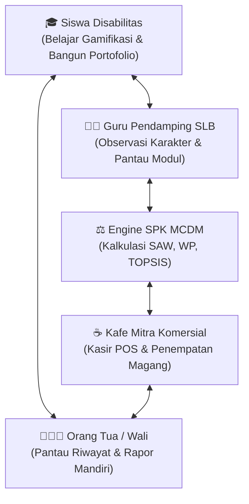

1. **Siswa dengan Ragam Disabilitas (*The Aspiring Talents*):** Siswa autisme, disabilitas sensorik netra/rungu, disabilitas intelektual, dan tunadaksa. Mereka membutuhkan antarmuka belajar visual, langkah instruksi yang terstruktur (*step-by-step*), sistem penguatan positif (*gamification badges*), serta aksesibilitas ramah neurodivergen.
2. **Guru & Instruktur Pendamping SLB (*The Dedicated Mentors*):** Pahlawan tanpa tanda jasa yang setiap hari membimbing siswa. Mereka membutuhkan instrumen evaluasi harian yang praktis untuk mencatat karakter (*soft skills*) tanpa terbebani administrasi manual yang rumit.
3. **Pengusaha Kafe Mitra Industri (*The Progressive Partners*):** Pelaku bisnis F&B yang sebenarnya memiliki itikad sosial tinggi untuk membuka lapangan kerja inklusif, namun dihantui rasa takut: *"Bagaimana bila operasional terganggu? Bagaimana jika terjadi salah takaran resep?"* Mereka memerlukan metrik kesiapan kerja yang transparan dan dapat dipertanggungjawabkan secara objektif.
4. **Orang Tua / Wali Murid (*The Hopeful Families*):** Pihak yang menanggung kecemasan terbesar: *"Bagaimana nasib anak saya kelak ketika saya sudah tiada?"* Mereka merindukan bukti nyata bahwa anak mereka mampu berdikari dan berkarya di tengah masyarakat.

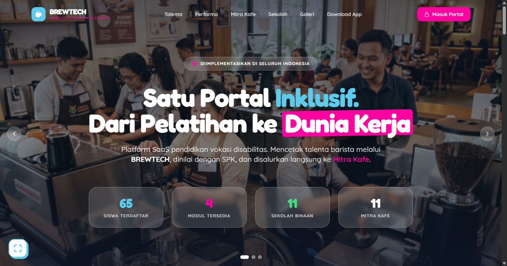
*Gambar 1: Halaman Depan Publik BREWTECH — Menghubungkan 65 Siswa Binaan, 11 SLB, dan 11 Kafe Mitra Nasional.*

---

## III. The Story of Now: Arsitektur Solusi & Implementasi Nyata

Saatnya telah tiba untuk menggantikan spekulasi dengan data, dan menggantikan keraguan dengan platform yang tangguh. Inilah bagaimana BREWTECH bekerja secara nyata, dari pintu masuk publik hingga ke mesin kasir kafe komersial:

### 3.1 Etalase Bakat Publik & Desain Aksesibilitas Universal
Langkah awal adalah meruntuhkan stigma di ruang publik. Halaman depan BREWTECH dirancang sebagai etalase prestisius yang menampilkan profil **"Top Talents"** barista binaan lengkap dengan asal sekolah SLB, kategori keahlian, dan indeks komputasi kesiapan kerja mereka.

Agar dapat diakses oleh semua ragam disabilitas, kami menyematkan **Accessibility Toolbar adaptif**:
- 🔊 **Text-to-Speech (TTS):** Membacakan isi teks untuk tunanetra atau *low-vision*.
- 🎨 **Filter Buta Warna:** Protanopia, Deuteranopia, Tritanopia, dan Monokromatik.
- 📖 **Font Ramah Disleksia:** Integrasi font khusus *OpenDyslexic*.
- 🔍 **Pembesar Kursor & Kontras Tinggi:** Mempermudah navigasi bagi motorik terbatas.

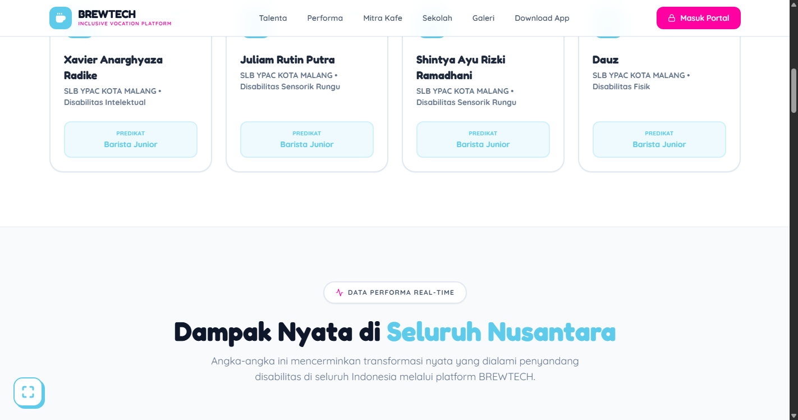
*Gambar 2: Bursa Talenta Unggul — Menampilkan Rekam Jejak dan Rekomendasi Akomodasi Kerja Siswa.*

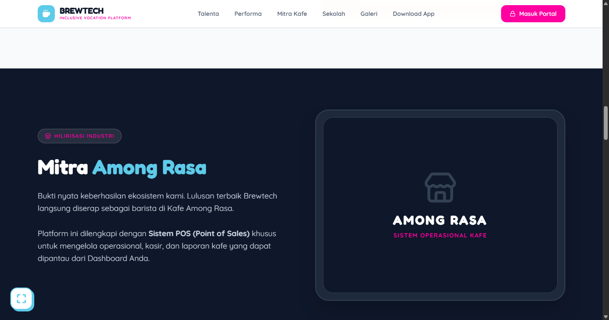
*Gambar 3: Galeri Dokumentasi Praktik Brewing & Jaringan Kemitraan Ekosistem SLB se-Indonesia.*

---

### 3.2 Gamifikasi Belajar: Mengubah Rasa Takut Menjadi Lencana Prestasi
Bagi siswa dengan hambatan belajar, lembar soal konvensional sering kali memicu kecemasan kognitif. Pada portal pembelajaran siswa (`/student/dashboard`), kurikulum barista dipecah menjadi modul interaktif mikro (*micro-learning*). 

Siswa dipandu melalui simulasi visual tentang kalibrasi grinder, takaran espresso, sanitasi *steam wand*, hingga *hospitality* etika melayani tamu. Setiap ketuntasan modul dihadiahi lencana prestasi (*badges*) dan perolehan bintang yang menumbuhkan rasa percaya diri.

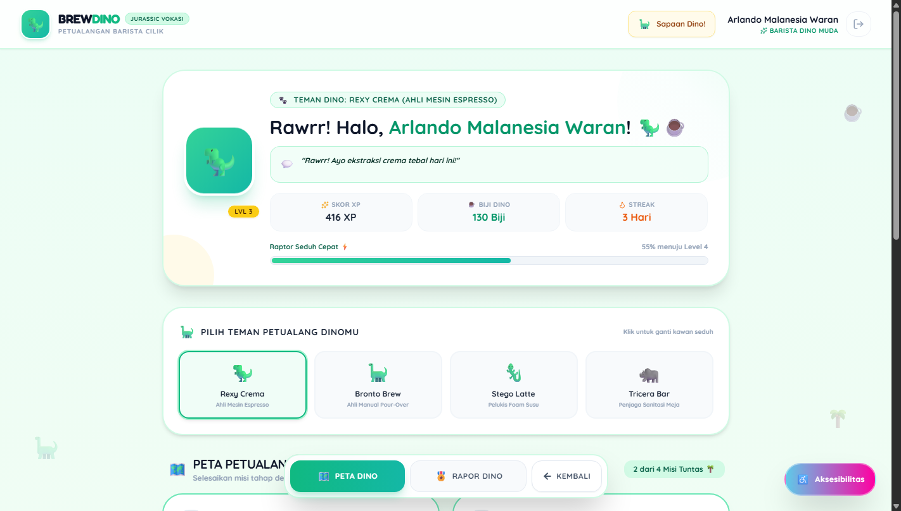
*Gambar 4: Dashboard Pembelajaran Siswa — Desain Gamifikasi dengan Pelacakan Modul dan Lencana Bintang.*

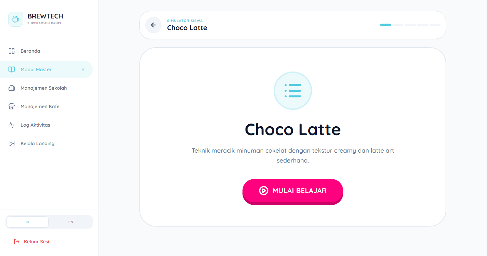
*Gambar 5: Pratinjau Kuis & Simulasi Soal Interaktif untuk Menakar Pemahaman Resep Barista.*

---

### 3.3 Penilaian Karakter Harian oleh Instruktur & Guru Pendamping
Keahlian meracik kopi (*hard skill*) hanyalah separuh dari keberhasilan kerja; separuh lainnya yang sangat krusial adalah karakter sosial (*soft skill*). Melalui portal instruktur (`/instructor/classes`), guru pendamping mengisi rubrik observasi berkala pada 5 indikator perilaku:
- Kedisiplinan & Ketepatan Waktu
- Higienitas & Kerapian Meja Bar
- Kerja Sama Tim & Adaptasi
- Komunikasi & Keramahan Pelanggan
- Inisiatif Mandiri

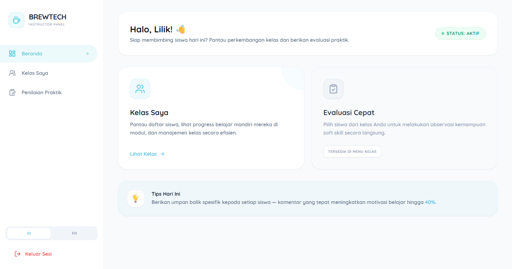
*Gambar 6: Dashboard Instruktur — Memantau Kelas Binaan dan Siswa yang Membutuhkan Pendampingan Khusus.*

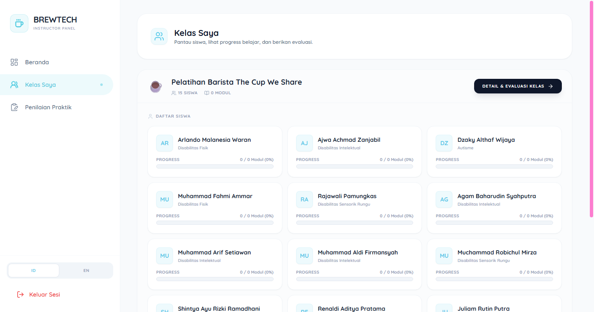
*Gambar 7: Rubrik Observasi Soft Skills — Menangkap Dinamika Sikap dan Etika Kerja Lapangan.*

---

### 3.4 Engine SPK MCDM: Transparansi Sains Menggantikan Subjektivitas
Inilah jantung kecerdasan buatan dan diferensiasi teknologi BREWTECH. Kami menolak formula penilaian arbitrer dan mengintegrasikan Engine **Multi-Criteria Decision Making (MCDM)** formal dengan 3 model matematis teruji:

1. **SAW (Simple Additive Weighting):**
   $$V_i = \sum_{j=1}^n w_j \cdot r_{ij}$$
   Menormalisasi matriks skor ke skala relatif [0, 1] dan menghitung preferensi terbobot linier.
2. **WP (Weighted Product):**
   $$S_i = \prod_{j=1}^n x_{ij}^{w_j}, \quad V_i = rac{S_i}{\sum S_k}$$
   Menggunakan perkalian eksponensial di mana tiap kriteria dipangkatkan dengan bobot terbobot, sangat selektif menyaring kandidat konsisten.
3. **TOPSIS (Ideal Solution Closeness):**
   $$C_i = rac{D_i^-}{D_i^+ + D_i^-}$$
   Menghitung jarak geometri Euclidean menuju Solusi Ideal Positif ($A^+$) dan terjauh dari Solusi Ideal Negatif ($A^-$).

Pada antarmuka `/school/reports`, Admin Sekolah dapat membandingkan perankingan antar-metode secara instan melalui **Algorithm Switcher Tabs**. Tersedia juga tombol **"MATRIKS ILMIAH"** yang membuka transparansi komputasi: menampilkan Matriks Keputusan Asal ($X$), Matriks Ternormalisasi ($R/Y$), Vektor $S$ dan $V$, hingga koordinat Solusi Ideal $A^+/A^-$.

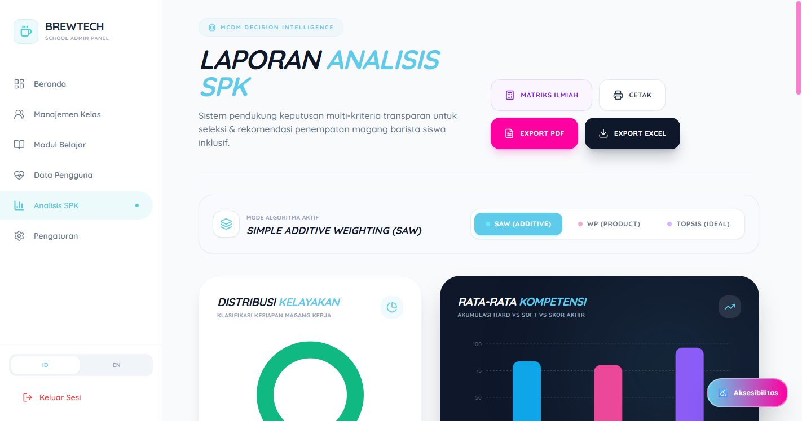
*Gambar 8: Laporan SPK MCDM Mutakhir — Tab Switcher Algoritma (SAW, WP, TOPSIS) dan Sebaran Analitik.*

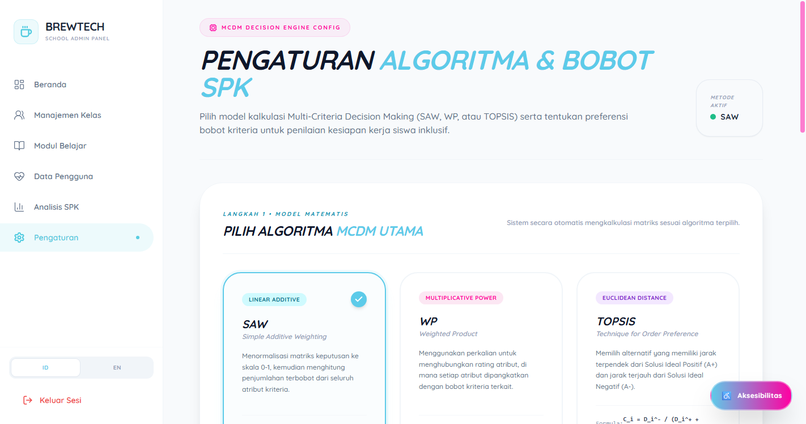
*Gambar 9: Pengaturan Algoritma SPK — Fleksibilitas Penyesuaian Bobot 6 Kriteria Kejuruan (C1 - C6).*

---

### 3.5 Dari Rapor Sekolah Langsung ke Mesin Kasir Kafe (Point-of-Sale)
Bukti keberhasilan BREWTECH bermuara di meja bar kafe komersial. Pada Portal Admin Kafe (`/cafe/pos`), mitra industri seperti **Kafe Among Rasa** menggunakan sistem kasir POS layar sentuh yang dirancang responsif dan ramah disabilitas.

Ketika melayani pesanan kopi (Espresso, Latte, Matchabiyu), kasir dapat menetapkan siswa magang yang bertugas meracik minuman tersebut. Dengan demikian, setiap struk belanja pelanggan merekam jam terbang dan kontribusi nyata siswa barista. Data ini terakumulasi otomatis ke dalam portofolio digital mereka.

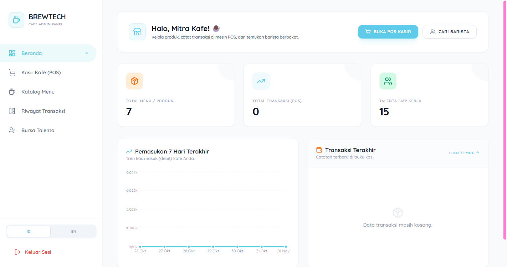
*Gambar 10: Dashboard Kafe Mitra (Among Rasa) — Rekapitulasi Omzet Penjualan dan Monitoring Kinerja Magang.*

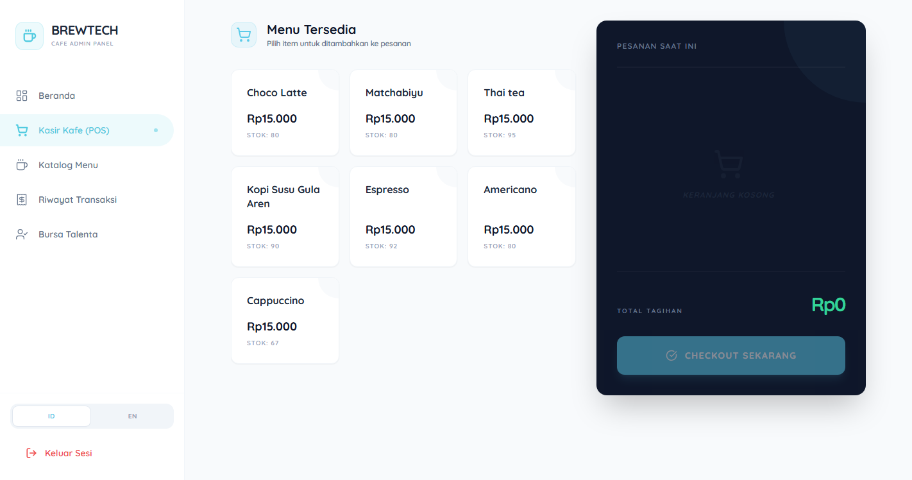
*Gambar 11: Aplikasi Kasir POS Layar Sentuh Inklusif — Mengintegrasikan Penjualan Riil dengan Jam Terbang Siswa.*

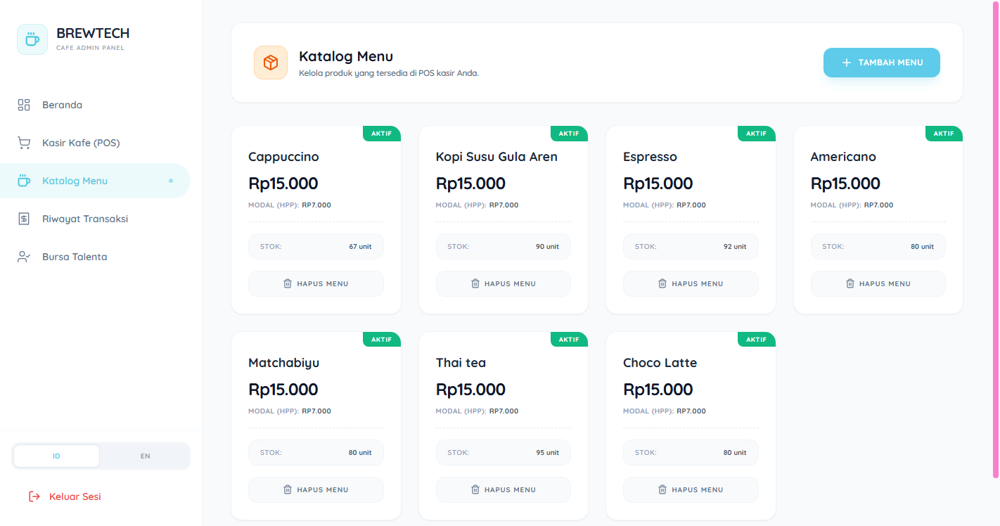
*Gambar 12: Katalog Produk & Inventori Minuman — Manajemen Stok Bahan Baku dan HPP.*

---

### 3.6 Menghapus Kecemasan Keluarga: Dashboard Orang Tua & Tata Kelola Superadmin
Bagi orang tua, portal wali murid (`/parent/dashboard`) adalah ruang haru dan kepastian. Mereka dapat melihat catatan apresiasi guru, histori modul kopi yang telah dituntaskan sang buah hati, serta skor kesiapan kerja mereka menuju dunia industri.

Di tingkat nasional, Superadmin mengontrol tata kelola SLB dan Kafe seluruh provinsi, memvalidasi kurikulum modul, memonitor CMS landing page, serta memantau Audit Activity Logs untuk integritas keamanan data.

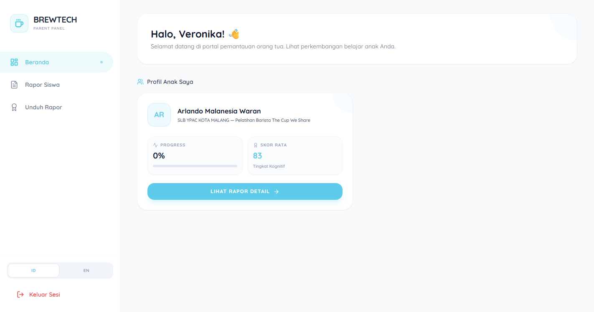
*Gambar 13: Dashboard Orang Tua — Menyajikan Bukti Kemajuan dan Menumbuhkan Kebanggaan Keluarga.*

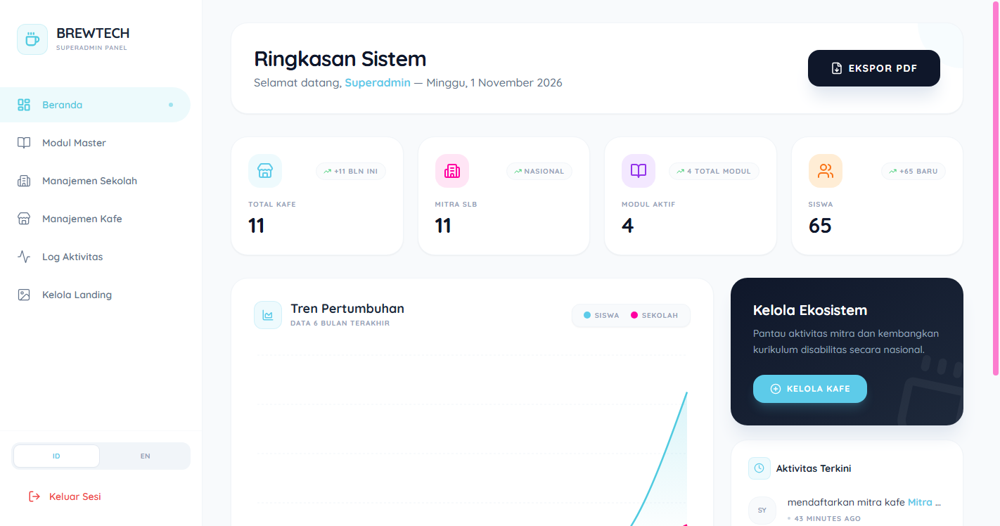
*Gambar 14: Dashboard Superadmin Nasional — Pemantauan Agregat Sekolah, Kafe, dan Modul se-Indonesia.*

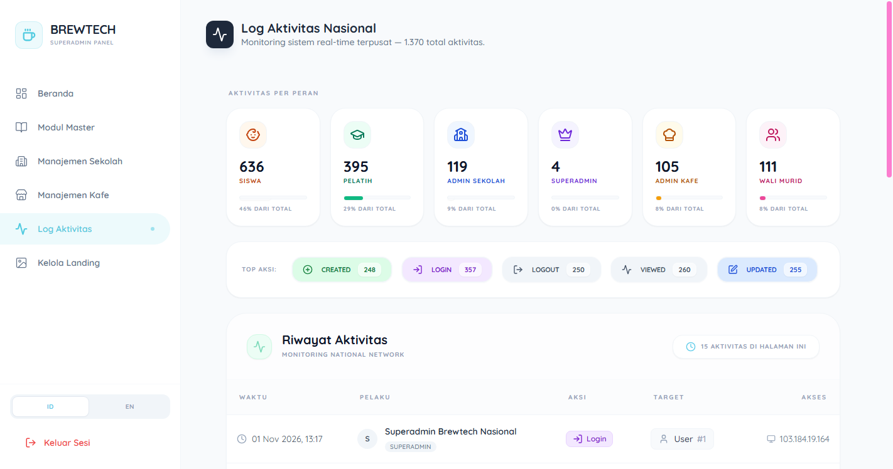
*Gambar 15: Pusat Rekam Jejak & Audit Activity Logs untuk Menjamin Integritas Sistem.*

---

## IV. Kedalaman Rekayasa Teknologi (Engineering Highlights)

1. **Serverless PHP Edge Computing:** Berjalan pada Laravel 10 serverless di Vercel dengan penyesuaian temporary directory (`/tmp/storage`) untuk caching view dan sessions.
2. **Inertia.js + React 18:** Pengalaman pengguna Single-Page Application (SPA) yang sangat mulus tanpa *latency routing* REST API konvensional.
3. **PostgreSQL Cloud di Supabase (AWS eu-west-2):** Koneksi pooler PgBouncer port 6543 dengan optimasi adapter boolean `PostgresConnection` untuk mencegah diskrepansi casting tipe data.
4. **CI/CD Otomatis via GitHub Actions:** Pipeline migrasi database otomatis yang mengeksekusi 29 skema tabel dan data seeder secara remote tanpa downtime.
5. **Ekspor Rapor Formal (Excel & DomPDF):** Kemampuan men-generate laporan analitik berkas cetak siap pakai dalam hitungan detik untuk keperluan akreditasi.

---

## V. Refleksi & Call to Action: Masa Depan Vokasi Inklusif

BREWTECH membuktikan bahwa rekayasa perangkat lunak terbaik bukan tentang seberapa rumit kode yang ditulis, melainkan seberapa besar kehidupan manusia yang dapat dimartabatkan oleh kode tersebut.

Ketika seorang siswa autisme yang dulunya dicap tidak mampu kini dapat berdiri tegak di balik mesin espresso kafe komersial, menyajikan secangkir latte hangat dengan senyuman tulus, dan dinilai secara adil oleh algoritma sains—di situlah teknologi menemukan makna tertingginya.

> *"Teknologi yang inklusif bukan sekadar fitur tambahan (add-on), melainkan manifestasi dari keadilan sosial dalam bentuk baris-baris kode."*

Kini, sistem ini siap direplikasi ke ratusan SLB dan jejaring kafe lainnya di seluruh penjuru tanah air. Mari bersama-sama mengubah belas kasihan menjadi kesempatan nyata—satu tegukan kopi, satu talenta mandiri, satu kebanggaan Indonesia.
